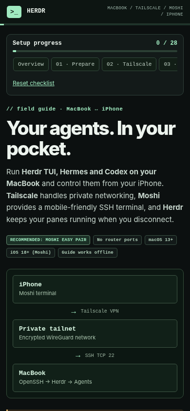

# Herdr Remote Ops

**An independent, interactive setup guide for controlling [Herdr](https://herdr.dev/) on a MacBook from an iPhone using [Tailscale](https://tailscale.com/) and [Moshi](https://getmoshi.app/).**

**[Open the interactive guide](https://renbo-macbook.github.io/herdr-remote-ops/)** · [View the HTML source](index.html)

## What it covers

- Secure private connectivity with Tailscale, without router port forwarding
- Mac SSH configuration, public-key login and effective-setting checks
- Moshi iPhone pairing, with a fallback manual SSH setup
- Herdr TUI sessions for monitoring or controlling coding agents, including Hermes and Codex
- iPhone-specific usage notes, including Moshi Free versus Pro
- Persistence, power and sleep limitations, connectivity tests and lost-device recovery

## Use the guide

Open the [GitHub Pages site](https://renbo-macbook.github.io/herdr-remote-ops/) in a browser, or download `index.html` and open it locally. Enter your own device identifiers as you follow the numbered instructions.

The guide is a **static HTML document**, not an installer. It doesn't run setup commands on your device. Its progress checklist and entered device identifiers are saved in your browser's local storage when allowed. Don't enter passwords, private keys, tokens or QR secrets.

> **Security notice:** Enabling macOS Remote Login can also expose SSH to the local network. Tailscale ACLs/grants do **not** restrict LAN traffic. Follow the guide's SSH-hardening tests, and keep local Mac access available until key authentication has been verified.

## Compatibility

Check current operating-system and feature requirements directly with the vendors before installation:

- [Tailscale macOS download and installation](https://tailscale.com/download/mac)
- [Moshi iOS app](https://getmoshi.app/)
- [Herdr documentation](https://herdr.dev/)

Moshi Free supports ordinary SSH; some Herdr integration and Mosh transport features require Moshi Pro. The guide distinguishes the two.

## Publish with GitHub Pages

In the repository, navigate to **Settings → Pages → Build and deployment**. Set **Source: Deploy from a branch**, **Branch: `main`**, **Folder: `/ (root)`**, then save. GitHub Pages will serve `index.html` at the website linked above once deployment succeeds.

## What's new in v1.1

- Step-by-step lost-phone response, including an SSH authorized-key backup, precise key revocation, and verification.
- Tailscale's documented **30-minute temporary node-key extension** for recovering an expired MacBook, with warnings about losing the only remote session.
- An explanation of OpenSSH `Include` expansion and the `050-` SSH hardening snippet's relationship to macOS configuration ordering.

The guide continues to require verification with `sshd -T` before considering SSH hardening effective. Optional Mosh roaming is supported through an explicit UDP grant toggle.

## Project information

This is an **unofficial community guide**, not endorsed by or affiliated with Herdr, Moshi, Tailscale, Apple or any other named project. Vendor names and trademarks belong to their respective owners. Commands and interfaces can change; validate them against the relevant vendor documentation and your device versions.

No open-source license is included. Public visibility alone does not grant permission to reuse or redistribute the source under an open-source license. The repository owner can add a license if they want to allow reuse or contributions.
